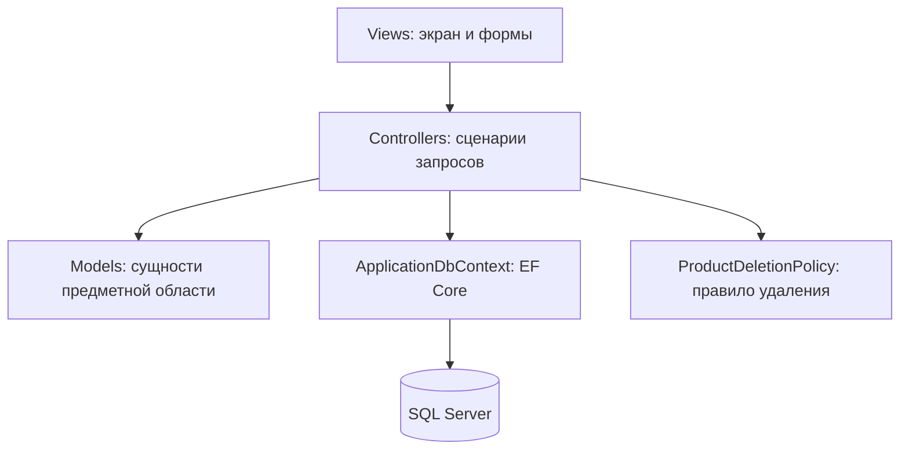

# Архитектура и требования к курсовому проекту

## Назначение

WebServiceCosmetics — прототип информационной системы учёта косметического производства. Основные сущности, для которых подтверждены CRUD-сценарии в исходном коде: продукты, сырьё и ингредиенты рецептуры.

## CRUD

| Сущность | Чтение | Создание | Изменение | Удаление | Реализация |
|---|---|---|---|---|---|
| Продукт | Да | Да | Да | Да, с проверкой зависимостей | ProductController |
| Сырьё | Да | Да | Да | Да, с ограничениями внешних ключей | RawMaterialsController |
| Ингредиент | Да | Да | Да | Да | IngredientController |

Удаление продукта удаляет принадлежащие его рецепту строки Ingredient. Если продукт уже использовался в производстве или продажах, удаление блокируется, чтобы не терять историю. Отказ показан пользователю на странице продуктов.

## Адрес сервиса

Профили запуска находятся в Properties/launchSettings.json:

- HTTP: http://localhost:5099
- HTTPS: https://localhost:7218
- IIS Express: http://localhost:14236 (SSL-порт 44355)

Это адреса локального прототипа для разработки; для опубликованной версии адрес задаётся окружением хостинга.

## Декомпозиция и модули

Приложение разделено по MVC и слоям хранения:

| Модуль | Ответственность | Внутренняя связность |
|---|---|---|
| Views | Отображение данных и формы CRUD | Функциональная: представление отвечает за экран |
| Controllers | Обработка сценария конкретной сущности | Функциональная: действия сгруппированы по продукту, сырью или ингредиентам |
| Models | Поля и связи сущностей | Информационная: поля описывают одну сущность |
| ApplicationDbContext | Конфигурация EF Core и отношений | Функциональная: доступ к сохранению и целостности данных |
| ProductDeletionPolicy | Проверка бизнес-правила удаления | Функциональная, СС=10: одна чистая проверка по двум булевым данным |

Внутреннее содержимое БД скрывает EF Core; контроллеру не нужно составлять SQL. При этом контроллеры напрямую используют ApplicationDbContext. Это рабочая, но заметная зависимость. Для следующей версии её можно уменьшить сервисным слоем или интерфейсами репозиториев.

## Связность и сцепление

Связность — насколько элементы одного модуля относятся к одной задаче; желательно стремиться к высокой связности. Сцепление — насколько один модуль зависит от другого; желательно низкое сцепление.

В проекте действия CRUD собраны в контроллерах по предметным сущностям, поэтому их связность преимущественно функциональная. Обмен между представлением и контроллером идёт через параметры запроса и модели. Сцепление между контроллером и БД выше желаемого, потому что контроллер зависит от конкретного ApplicationDbContext.

| Связь модулей | Тип сцепления | Оценка |
|---|---|---:|
| Представление → контроллер | По данным: id и поля формы | СЦ=1 |
| Контроллер → модель | По образцу: передаётся объект модели | СЦ=3 |
| Контроллер → ApplicationDbContext | По образцу: контроллер вызывает методы контекста и использует DbSet | СЦ=3 |
| Контроллер → ProductDeletionPolicy | По данным: два простых булевых значения и булев результат | СЦ=1 |
| ApplicationDbContext → SQL Server | Через инфраструктурный интерфейс EF Core | Низкое/инфраструктурное |

Оценки СЦ относятся к учебной шкале из задания. Они описывают тип передачи между модулями, а не автоматический результат статического анализатора.

## Связность по заданной шкале

| Тип связности | СС | Применение в проекте |
|---|---:|---|
| Функциональная | 10 | CRUD-действия одного контроллера относятся к одной сущности |
| Информационная / последовательная | 9 | Результат чтения передаётся в представление для показа |
| Коммуникативная | 7 | Несколько действий используют одну сущность или общий DbContext |
| Процедурная | 5 | Операции выполняются в определённом порядке |
| Временная | 3 | Начальная настройка приложения выполняется при запуске |
| Логическая | 1 | Несвязанные операции объединены по категории |
| По совпадению | 0 | Общих задач у элементов модуля нет |

## Структурные показатели

Для учебной схемы одного сценария «список продуктов» считаются слои:

1. Представление Products/Index.
2. ProductController.
3. ApplicationDbContext / EF Core.
4. SQL Server.

Итого для этой схемы: 4 вершины-модуля, 3 направленные связи по цепочке, высота — 4 уровня, ширина — 1 модуль на каждом уровне выбранного сценария. Это показатели указанного среза, не подсчёт всех файлов проекта.

## Метрики сложности кода

Для модуля с n1 различными операторами и n2 различными операндами оценочная длина Хэлстеда:

`N̂ = n1 log2(n1) + n2 log2(n2)`

Объём:

`V = N log2(n1 + n2)`

Пример для метода `ProductDeletionPolicy.HasHistory`. В расчёте считаются только исполняемое выражение `hasManufacturing || hasSales`; объявления метода не включены. Тогда n1=1 (оператор `||`), n2=2 (два операнда), N1=1, N2=2, фактическая длина N=3, оценочная длина N̂=2, объём V=2·log2(3)≈3,17. При другом правиле токенизации значения Хэлстеда изменятся; правило подсчёта поэтому указано явно.

Цикломатическая сложность связного графа управления:

`V(G) = E − N + 2`

где E — число рёбер, N — число узлов графа управления. Для нескольких независимых компонент применяется `V(G) = E − N + 2P`. У `ProductDeletionPolicy.HasHistory` одно логическое условие, поэтому V(G)=2. Формула «E*N - 2» из конспекта выглядит как опечатка; см. [руководство NIST по цикломатической сложности](https://nvlpubs.nist.gov/nistpubs/Legacy/SP/nistspecialpublication500-235.pdf).

## Прототипирование, читаемость и стандарты

Приложение является прототипом, если запускается, подключается к SQL Server и демонстрирует перечисленные CRUD-сценарии. Запуск и демонстрацию следует выполнять с тестовыми данными.

Для читаемости используются отдельные контроллеры, модели и контекст данных, говорящие имена и форматирование C#. При дальнейшем развитии рекомендуется вынести повторяемые правила в сервисы, централизовать проверку ролей, убрать дублирующиеся директивы using и регистрации сервисов, а также придерживаться единого английского именования в коде.